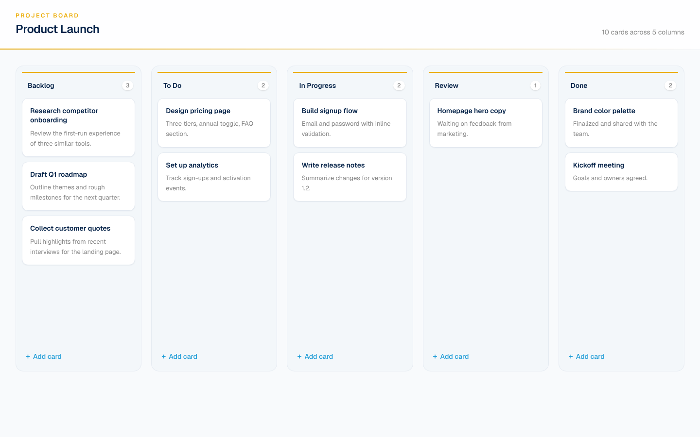

# Kanban

A single-board Kanban app built as an MVP. Clean UI, minimal features.



## Features

- One board with 5 fixed columns, each can be renamed
- Cards with a title and details
- Add and delete cards
- Drag and drop cards within and between columns
- Opens with sample data (no persistence)

## Tech stack

- Next.js 16, React 19, TypeScript
- Tailwind CSS 4
- dnd-kit for drag and drop
- Vitest and React Testing Library for unit tests
- Playwright for end-to-end tests

## Getting started

```
cd frontend
npm install
npm run dev
```

Open http://localhost:3000

## Tests

```
cd frontend
npm test
npx playwright install chromium
npm run test:e2e
```

## Project structure

```
frontend/
  src/app/          Next.js app router entry
  src/components/   Board, Column, Card, AddCard
  src/lib/          Board state logic and seed data
  e2e/              Playwright tests
```

See `PLAN.md` for the build plan and `AGENTS.md` for the requirements.
